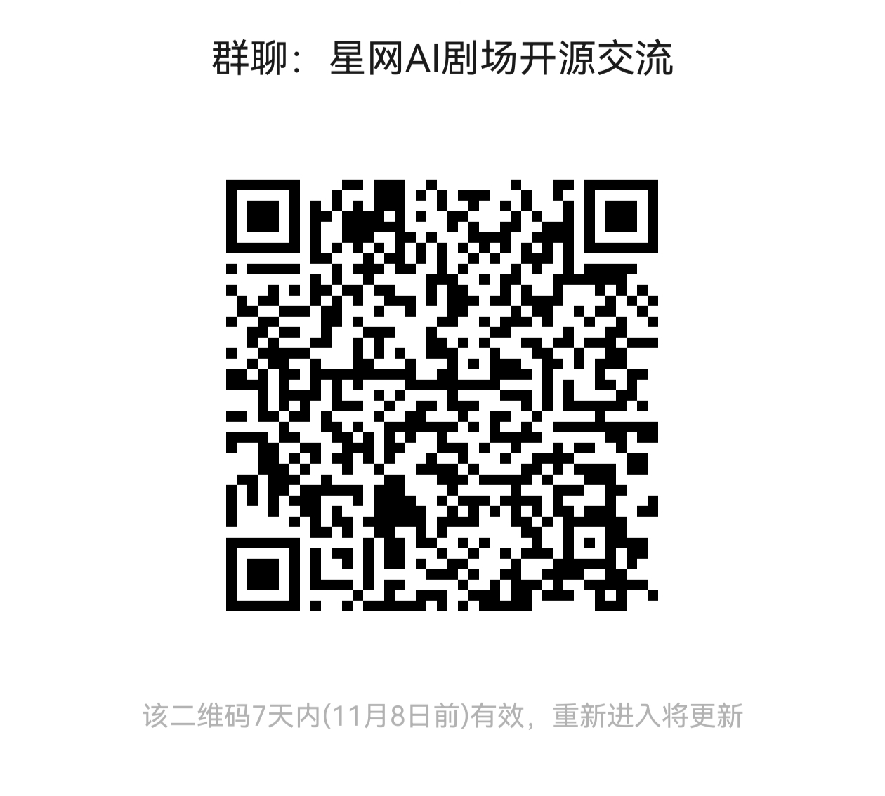

**🌐 Language**: [简体中文](README.md) | [English](README.en.md) | [繁體中文](README.zh-TW.md) | [日本語](README.ja.md) | [한국어](README.ko.md) | [Español](README.es.md) | [Français](README.fr.md) | [Deutsch](README.de.md) | [Português](README.pt-BR.md) | [Русский](README.ru.md) | [Italiano](README.it.md) | [Türkçe](README.tr.md) | [Tiếng Việt](README.vi.md) | [ไทย](README.th.md) | [Bahasa Indonesia](README.id.md) | [Nederlands](README.nl.md) | [Polski](README.pl.md) | [Українська](README.uk.md) | [हिन्दी](README.hi.md) | **العربية** | [فارسی](README.fa.md)

<div dir="rtl">

# 🎬 星网 XW.COM · منصة إنتاج المسلسلات القصيرة بالذكاء الاصطناعي

> 🌐 **نسخة تجريبية عبر الإنترنت**: <https://aiwork.xw.com> 　·　📮 تواصل معنا: **kevin@xw.com**

نظام متكامل لإنتاج المسلسلات القصيرة بالذكاء الاصطناعي: **استيراد السيناريو ← استخراج الشخصيات/المشاهد/الدعائم ← توليد لوحة القصص المصورة (Storyboard) ← توليد فيديو كل لوحة ← تجميع الحلقة كاملة**.
يعمل الخادم بـ **Node.js + MySQL (مع رجوع تلقائي إلى / SQLite)**، أما الواجهات فـ **Vue 3 + Element Plus** بنسختين: **Web (المجلد client، ويشمل لوحة الإدارة client/admin وغلاف سطح المكتب client/desktop) + الجوال (uniapp، أغلفة App/التطبيق المصغّر/H5)**، ويتواصلان عبر REST API. نظام الحسابات **تسجيل/دخول محلي مدمج** (اسم مستخدم/بريد إلكتروني/رقم هاتف + كلمة مرور) ولا يعتمد على أي مركز حسابات تابع لجهة خارجية.

---

## 🌐 النسخة التجريبية والتواصل

- **رابط التجربة**: <https://aiwork.xw.com>
- **الإبلاغ عن المشكلات / التعاون**: <kevin@xw.com>

---

## ✨ الميزات

| الوحدة | الوصف |
|---|---|
| 👤 نظام المستخدمين | **تسجيل/دخول محلي** (اسم مستخدم/بريد/هاتف + كلمة مرور، مع كابتشا اختيار نص إلزامية عند التسجيل) + **مشاريع مشتركة للفريق** (دعوات/صلاحيات)|
| 📖 مخطط السيناريو | الصق السيناريو أو استورده كملف `.txt`، و**يقسمه الذكاء الاصطناعي إلى حلقات متعددة** قابلة للتحرير حلقةً حلقة |
| 🎭 مكتبة الأصول | **يستخرج الذكاء الاصطناعي الشخصيات / المشاهد / الدعائم**، وتوليد صور الأصول واحدةً واحدة أو دفعة واحدة |
| 🎬 فيديو الحلقات | **يولّد الذكاء الاصطناعي نص لوحة القصص المصورة** (نص المقطع + التعليق الصوتي + إعداد الصوت + المدة)|
| ✂️ محرر لوحة القصص المصورة | الأصول على اليسار، نص اللوحات في الوسط، معاينة الفيديو على اليمين، وخط زمني للحلقة في الأسفل |
| 🎞️ توليد الفيديو | لكل مقطع: (TTS اختياري) ← فيديو المقطع، وبعد التوليد يُستخرج الإطار الأول تلقائيًا كغلاف للمعاينة |
| 🧩 تجميع الحلقة كاملة | يدمج ffmpeg المقاطع المختارة ويخرج ملف mp4 للحلقة كاملة |
| 🔧 إعداد النماذج اللغوية الكبيرة | **الإعداد بالكامل من لوحة الإدارة** (أربع فئات: نص/صورة/فيديو/صوت، مع تفعيل/تعطيل / استيراد / تصدير)|
| 💰 فوترة بالنقاط | لكل خطوة تستدعي نموذجًا لغويًا أو وسيطًا إعلاميًا سعر محدد، و**تُخصم النقاط حسب الاستهلاك** |
| 💳 شحن الرصيد | باقات جاهزة + **WeChat Pay (V3 · مسح رمز Native / JSAPI)**، مع خصم النقاط حسب الاستهلاك |
| 🎨 المظهر | فاتح / داكن / تلقائي بحسب النظام |

### الأسعار (قابلة للتعديل، القيم الافتراضية)
| الميزة | الوحدة | النقاط |
|---|---|---|
| تقسيم السيناريو | لكل 1000 كلمة | 10 |
| استخراج الأصول | لكل حلقة | 20 |
| توليد صور الأصول | لكل صورة | 5 |
| **توليد نص لوحة القصص المصورة** | **لكل 100 كلمة** | **2** |
| **توليد فيديو لوحة القصص المصورة** | **لكل ثانية** | **11** |
| التعليق الصوتي (TTS) | لكل 100 كلمة | 3 |
| تجميع الفيديو | لكل حلقة | 30 |

---

## 📂 بنية المجلدات

```
AIDrama/
├─ server/            # خادم Node.js + Express + Sequelize
│  ├─ src/
│  │  ├─ db/models/        # نماذج جداول قاعدة البيانات + العلاقات
│  │  ├─ middleware/       # auth(JWT) / error
│  │  ├─ routes/           # مسارات REST (المشاريع/الأصول/اللوحات/الفيديو/النقاط/الشحن/العرض/الطلبات/الإدارة…)
│  │  ├─ services/         # credits / llm / image / video / tts / ffmpeg / ai/* …
│  │  ├─ utils/            # response / ownership / fileUtil / mediaSign …
│  │  ├─ seeders/          # الأسعار + كتالوج مزوّدي النماذج الافتراضي + المدير الأولي
│  │  └─ app.js / index.js
│  └─ .env.example
├─ client/            # واجهة الويب Vue 3 + Vite + Element Plus
│  ├─ src/{views,layouts,components,stores,api,composables,styles}
│  ├─ src/admin/           # لوحة الإدارة (مدخل مستقل /admin، بتسجيل دخول ورمز مستقلين)
│  ├─ admin.html           # ملف HTML لمدخل لوحة الإدارة
│  └─ desktop/             # غلاف سطح المكتب Electron (Windows/macOS، راجع client/desktop/README.md)
├─ uniapp/            # واجهة الجوال (uni-app: App / غلاف التطبيق المصغّر / H5)
└─ deploy/            # نشر الإنتاج: nginx.conf / PM2 / systemd / backup / دليل تشغيل DEPLOY.md
```

---

## 🚀 البدء السريع

### 1. تشغيل الخادم

```bash
cd server
cp .env.example .env          # الافتراضي DB_DIALECT=sqlite، ويعمل بلا أي إعداد مسبق
npm install
npm run dev                   # http://localhost:3000 ، مع إنشاء الجداول تلقائيًا + seed
```

- **SQLite (جاهز فور التشغيل، ويُنصح به للتجربة المحلية)**: `DB_DIALECT=sqlite`، وتُخزَّن البيانات في `server/data/aidrama.db`
- **MySQL**: اضبط `DB_DIALECT=mysql` واملأ `DB_HOST/DB_PORT/DB_NAME/DB_USER/DB_PASSWORD`
- **يُنشأ المدير الأولي تلقائيًا عند أول تشغيل** (ستظهر رسالة في وحدة التحكم):
  - الحساب الافتراضي **`admin / admin123`**، ويُستخدم للدخول إلى لوحة الإدارة `/admin`
  - يمكن تجاوزه عبر متغيّرَي البيئة `ADMIN_INIT_USERNAME` / `ADMIN_INIT_PASSWORD`؛ وإذا وُجد مدير مسبقًا تُتخطى هذه الخطوة
  - ⚠️ غيّر كلمة المرور الافتراضية فورًا قبل الإطلاق (`node scripts/setAdminPassword.js`، أو راجع قسم لوحة الإدارة أدناه)

### 2. تشغيل الواجهة

```bash
cd client
npm install
npm run dev                   # http://localhost:5173
```

افتح <http://localhost:5173>: إن لم يكن لديك حساب فاضغط «تسجيل» (اسم مستخدم + كلمة مرور، مع اجتياز كابتشا اختيار نص؛ وبعد التسجيل الناجح يتم الدخول تلقائيًا وتُمنح 66 نقطة تجريبية)؛ وإن كان لديك حساب فسجّل الدخول مباشرة (اسم مستخدم / بريد إلكتروني / رقم هاتف، أيٌّ منها يكفي).

> الواجهة مزوّدة بوكيل مهيأ مسبقًا، إذ يُحوَّل `/api` و`/files` تلقائيًا إلى `http://localhost:3000`.

---

## 🛠 استخدام لوحة الإدارة (client/admin)

لوحة الإدارة ذات **مدخل مستقل، وتسجيل دخول مستقل، ورمز مستقل** (رمز JWT بالبادئة `admt_`، ولا علاقة له بجلسات مستخدمي الواجهة الأمامية):

- **المدخل**: <http://localhost:5173/admin> (وفي بيئة الإنتاج `https://نطاقك/admin`)
- **تسجيل الدخول**: حساب + كلمة مرور + كابتشا اختيار نص. عند أول تشغيل استخدم المدير الأولي **`admin / admin123`**؛
- **تغيير كلمة المرور**: لا توجد حاليًا صفحة لتغيير كلمة المرور داخل اللوحة، فاستخدم سكربت الخادم لإعادة التعيين:
  ```bash
  cd server
  node scripts/setAdminPassword.js <اسم المستخدم أو البريد> <كلمة المرور الجديدة>
  ```
  (يسمح دخول `adminAuth` باستخدام اسم المستخدم / البريد / رقم الهاتف أيٍّ منها كحساب)

### الوحدات الوظيفية

| الوحدة | الغرض |
|---|---|
| **إعداد النماذج** | **ربط نماذج LLM للفئات الأربع: نص / صورة / فيديو / TTS** (راجع القسم التالي؛ الإعداد إلزامي قبل الإطلاق)|
| مزوّدو النماذج | كتالوج المزوّدين والنماذج (مصدر الإعدادات الجاهزة عند إضافة إعداد جديد؛ وكتالوج أهم المزوّدين مضمَّن في seed)|
| الأنماط الفنية / خيارات الشخصيات / مكتبة الأصوات | قواميس مواد الإبداع (وتُضبط منها الخيارات المتاحة في الواجهة الأمامية)|
| الأسعار | سعر النقاط لكل خطوة ذكاء اصطناعي (راجع الجدول أعلاه)|
| إدارة المستخدمين | البحث عن المستخدمين، **الحظر/رفع الحظر**، **إعادة تعيين كلمة المرور** (المدخل الموحد لحالة نسيانها)، تعديل النقاط، **الدخول إلى واجهة المستخدم نيابةً عنه بنقرة واحدة** (login-as، لفحص مشكلاته من منظوره)|
| المدفوعات | الاستعلام عن طلبات الشحن عبر WeChat / مطابقتها |
| مراجعة العرض | نشر أعمال مركز العرض أو إيقافها |
| إدارة المهام / إدارة توليد الفيديو | إعادة المحاولة/التنظيف لقوائم المهام غير المتزامنة وطابور توليد الفيديو |
| الصيانة | مفتاح وضع الصيانة (503 + الوقت المتوقع للتعافي)، وصيانة البيانات |
| سجل الدخول | سجلات دخول الموقع بالكامل (الطريقة / IP / UA) |

---

## 🔌 إعداد النماذج اللغوية / الوسائط (لتشغيل مزايا الذكاء الاصطناعي فعلًا)

جميع قدرات الذكاء الاصطناعي **مدفوعة بالإعدادات**، وتُدار **بشكل موحّد من صفحة «إعداد النماذج» في لوحة الإدارة** (لم يعد `.env` يوفر أي إعداد افتراضي للنماذج). وعند عدم الإعداد: تعرض المزايا النصية تنبيهًا قبل الاستدعاء، بينما ترجع الصورة/الفيديو/TTS خطأ «غير مُعدّ» مباشرة.

خطوات الإعداد:

1. سجّل الدخول إلى لوحة الإدارة `/admin` ← **إعداد النماذج** ← إضافة؛
2. اختر الفئة (نص / صورة / فيديو / TTS) والبروتوكول، ثم املأ:
   - **Base URL** (مثل `https://api.openai.com/v1`)
   - **API Key** (يُخزَّن على الخادم فقط ولا يُرسل إلى الواجهة)
   - **اسم النموذج** (مثل `gpt-4o-mini` و`dall-e-3`)
   - حالة التفعيل وسعر النقاط لهذا الإعداد؛
3. بعد الحفظ تصبح متاحة فورًا في الواجهة (يمكن إعداد عدة إعدادات للفئة نفسها والتبديل بينها بالتفعيل/التعطيل)؛ وتدعم صفحة «إعداد النماذج» **استيراد / تصدير JSON** لتسهيل النقل بالجملة.

البروتوكولات المدعومة:

- **نص / صورة / TTS**: متوافق مع OpenAI (`/chat/completions` و`/images/generations` و`/audio/speech`) أو نقطة نهاية مخصصة (`api_style=custom`)
- **فيديو**: تُعدَّل نقطة نهاية للمهام غير المتزامنة (إرسال ← استقصاء ← رابط الفيديو)؛ ويلزم مزوّد حقيقي لتوليد الفيديو (أُوقفت ميزة «تحويل الصورة إلى فيديو» المحلية عبر ffmpeg)

> يمكن للمستخدم أيضًا إضافة **نموذج خاص** من «الإعدادات الشخصية ← نماذجي» (بمفتاحه الخاص، ولا تُخصم نقاط على استدعاءاته)، دون أي تأثير على الإعداد العام.
> يلزم تثبيت `ffmpeg` محليًا (على macOS: `brew install ffmpeg`). وعليه يعتمد دمج مقاطع الفيديو في التجميع.

---

## 🚢 النشر في بيئة الإنتاج

دليل التشغيل الكامل في **[deploy/DEPLOY.md](deploy/DEPLOY.md)** (قائمة تحقق الإطلاق مع nginx، وPM2/systemd بنسخة واحدة، والنسخ الاحتياطي والاستعادة، وإطلاق WeChat Pay، ومهام الامتثال). الحد الأدنى لمتطلبات البيئة:

```bash
NODE_ENV=production            # إن لم يُضبط فسيُستخدم مفتاح JWT الاحتياطي للتطوير، وهو خطر أمني
JWT_SECRET=<مفتاح توقيع رموز الجلسة المحلية، سلسلة عشوائية طويلة>      # هذا النظام يوقّع جلسات المستخدمين ويتحقق منها بنفسه (axt_)
ADMIN_JWT_SECRET=<مفتاح توقيع مستقل للوحة الإدارة>
FILE_SIGN_SECRET=<مفتاح توقيع حماية الوسائط من التحميل الساخن>   # يجب أن يطابق مفتاح secure_link في deploy/nginx.conf
PUBLIC_BASE_URL=https://your-domain.com
CLIENT_ORIGIN=https://your-domain.com
DB_DIALECT=mysql               # + DB_HOST/DB_PORT/DB_NAME/DB_USER/DB_PASSWORD
```

ويحتاج WeChat Pay بالإضافة إلى ذلك حزمة `WECHAT_PAY_*` المكوّنة من خمسة عناصر (رقم التاجر، AppID، مفتاح APIv3، الرقم التسلسلي للشهادة، المفتاح الخاص للتاجر)، راجع `deploy/DEPLOY.md` ⑦.

---

## 🔑 تسجيل الدخول ونظام الحسابات (محلي، بلا تبعيات خارجية)

نظام الحسابات **مدمج في هذا النظام**: التسجيل / الدخول / تغيير كلمة المرور / تجديد الجلسة، كلها تمر عبر `/api/auth/*` على هذا الخادم نفسه، دون الاعتماد على أي مركز حسابات خارجي:

- **التسجيل**: اسم مستخدم (2-64 حرفًا: حروف لاتينية وأرقام و`_.-`) + كلمة مرور (6 أحرف فأكثر) + بريد إلكتروني (اختياري)، مع كابتشا اختيار نص إلزامية (الأسئلة تُولَّد بصيغة SVG من الخادم، `/api/captcha/*`)؛ والتسجيل الناجح يعني الدخول تلقائيًا مع منح 66 نقطة تجريبية؛
- **الدخول**: اسم مستخدم / بريد إلكتروني / رقم هاتف (أيٌّ منها) + كلمة مرور؛ والكابتشا «تُتحقق فقط إن قُدِّمت» (ترسلها الواجهة افتراضيًا)؛
- **الرموز**: يوقّع الخادم رموز JWT بنفسه (بالبادئة `axt_`، مع access + refresh دون تدوير refresh)، وتجدد الواجهة الجلسة بصمت عبر `/api/auth/oauth/refresh`؛ ورمز لوحة الإدارة مستقل (بالبادئة `admt_`)؛
- **نسيان كلمة المرور**: لا توجد قنوات SMS/بريد في النسخ المثبتة ذاتيًا، لذا لا يتوفر استعادة ذاتية — يتولى المدير ذلك من **لوحة الإدارة «إدارة المستخدمين» ← إعادة تعيين كلمة المرور**؛
- **الحظر**: بعد حظر المستخدم تصبح جميع رموزه الصادرة لاغية عند أول طلب تالٍ (يعيد الخادم فحص حالة المستخدم مع كل طلب)؛
- **الدخول عبر جهات خارجية (اختياري)**: لا يزال تسجيل الدخول بنقرة واحدة عبر Apple / Google متاحًا في تطبيق الجوال — يقوم الخادم بالتبادل كوكيل يحتفظ بالمفاتيح (`POST /api/auth/oauth/:provider`) ويُعيد الجلسة المحلية نفسها `axt_`؛ ولا يحتاج الويب إلى تسجيل أي عناوين رجوع.

متغيّرات `.env` ذات الصلة: `JWT_SECRET` و`ADMIN_JWT_SECRET` و`CAPTCHA_TICKET_SECRET` و`ADMIN_INIT_USERNAME` و`ADMIN_INIT_PASSWORD` (جميعها مشروحة في تعليقات `server/.env.example`).

---

## 💚 WeChat Pay (V3 · مسح رمز Native / JSAPI)

WeChat Pay حقيقي، **مدفوع بالإعدادات ومعطَّل افتراضيًا** (إذا تُركت `WECHAT_PAY_*` فارغة في `.env` فالميزة غير مفعلة، وتخفي الواجهة مدخل الشحن تلقائيًا). ويُبقي `WECHAT_APP_ID` كقيمة احتياطية لـ AppID الخاص بالدفع.

فعّل الدفع عبر Native/JSAPI على [منصة تجار WeChat](https://pay.weixin.qq.com/)، واحصل على رقم التاجر ومفتاح APIv3، ونزّل شهادة API الخاصة بالتاجر (`apiclient_key.pem` + الرقم التسلسلي للشهادة). **يجب إتمام ربط رقم التاجر مع AppID على منصة التاجر** (وإلا فشل إنشاء الطلب بخطأ `APPID_MCHID_NOT_MATCH`). الإعداد:
```bash
WECHAT_PAY_METHOD=native       # native=مسح رمز QR | jsapi=الدفع داخل الحساب الرسمي (PC يمر عبر صندوق H5)
WECHAT_PAY_APP_ID=             # AppID المرتبط برقم التاجر (إن تُرك فارغًا فيرجع إلى WECHAT_APP_ID)
WECHAT_PAY_MCH_ID=<رقم التاجر الخاص بك>
WECHAT_PAY_API_V3_KEY=         # مفتاح APIv3 بطول 32 حرفًا
WECHAT_PAY_SERIAL_NO=          # الرقم التسلسلي لشهادة API الخاصة بالتاجر
WECHAT_PAY_PRIVATE_KEY_PATH=cert/apiclient_key.pem   # المسار على القرص لملف apiclient_key.pem (أحدهما مع السطر التالي)
WECHAT_PAY_PRIVATE_KEY=        # أو نص PEM مضمَّن مباشرة
WECHAT_PAY_NOTIFY_URL=         # إن تُرك فارغًا فسيُؤخذ ${PUBLIC_BASE_URL}/api/recharge/wechat/notify
```
- المسار: اختر «WeChat Pay» من مركز النقاط ← ينشئ الخادم الطلب الموحد (يرجع Native رمز `code_url` لعرض رمز QR / ويستدعِ JSAPI الدفع) ← يدفع المستخدم ← ثم يصل رد WeChat غير المتزامن على `/api/recharge/wechat/notify` (تحقق وفك تشفير AES-256-GCM، وقيد رصيد idempotent).
- يجب أن يكون عنوان الرد **عنوان HTTPS متاحًا على الإنترنت العام** (يمكن خلال التطوير استخدام نفق للشبكة الداخلية).

> خطوات الإطلاق (ربط AppID على منصة التاجر، ووضع الشهادة محليًا على الخادم، واختبار رجعي بطلب حقيقي بقيمة سنت واحد) راجع **[deploy/DEPLOY.md](deploy/DEPLOY.md) ⑦ خطوات إطلاق WeChat Pay**.
> قاعدة البيانات: يُكتب رقم تسلسل طلب الدفع في `recharge_orders.transaction_id`، ويُستكمل بشكل idempotent عبر `ensureColumns` عند الإقلاع دون التأثير على القواعد القديمة.

---

## 🧪 خطوات التحقق من البداية إلى النهاية

0. لوحة الإدارة `/admin` (admin/admin123) ← **إعداد النماذج** ← اضبط الفئات الأربع: نص/صورة/فيديو/TTS (وإلا لن تعمل خطوات الذكاء الاصطناعي)
1. تسجيل/دخول في الواجهة ← مشروع جديد ← «مخطط السيناريو»: الصق السيناريو أو ارفعه ← **تقسيم السيناريو بالذكاء الاصطناعي** (يخصم نقاطًا)
2. «مكتبة الأصول» ← **استخراج الأصول بالذكاء الاصطناعي** ← **توليد صور الأصول** للشخصيات/المشاهد
3. «فيديو الحلقات» ← **توليد النص** ← الدخول إلى **محرر لوحة القصص المصورة**
4. اختر مقطعًا داخل المحرر ← **توليد فوري** (فيديو المقطع، مع استخراج الإطار الأول تلقائيًا كغلاف للمعاينة)
5. **تجميع الحلقة كاملة** (يدمج ffmpeg الحلقة كاملة في mp4)
6. راجع السجل والشحن في «مركز النقاط»؛ وفي لوحة الإدارة عدّل الأسعار / احظر / أعد تعيين كلمة المرور / اطّلع على سجل الدخول؛ وبدّل المظهر فاتح/داكن/تلقائي

---

## 📡 أهم واجهات API (بالبادئة `/api`، ومصادقة JWT، وبصيغة موحدة `{code,message,data}`)

```
POST /auth/register | /auth/login                              # تسجيل محلي (يلزم تذكرة الكابتشا) / دخول (عام، بحد معدل)
POST /auth/password                                            # تغيير كلمة المرور (بحالة دخول)
POST /auth/oauth/refresh                                       # تجديد صامت (استبدال refresh_token بـ access_token جديد، عام)
POST /auth/oauth/:provider                                     # تبديل دخول جهة خارجية بجلسة محلية (apple/google/weixin/huawei، اختياري)
GET /auth/me   POST /auth/sync                                 # ملف المستخدم
POST /captcha/challenge | /captcha/verify                      # كابتشا اختيار النص
GET/POST/PUT/DELETE /projects          GET /projects/:id
POST /projects/:id/script/import       POST /projects/:id/script/parse
POST /projects/:id/extract             GET /projects/:id/assets  POST /assets/:id/generate-image
POST /episodes/:id/generate-storyboard GET /episodes/:id/segments
POST /segments/:id/generate            PUT /segments/:id
POST /episodes/:id/compose             GET /episodes/:id/video
GET /jobs                                                              # مركز المهام غير المتزامنة (تستقصيه الواجهة)
GET /model-configs                     POST /model-configs/import  GET /model-configs/export   # جهة قراءة الإعداد العام + الاستيراد/التصدير (تُدار من لوحة الإدارة)
GET /credits/balance | /credits/transactions
GET /recharge/packages  POST /recharge/create  GET /recharge/orders/:id
POST /recharge/wechat/notify                                   # رد WeChat Pay (بلا مصادقة، تحقق توقيع + idempotent)
GET /showcase/*                                                # مركز العرض (النشر/التصفح/اصنع مثله)
GET /market/*                                                  # مركز استلام الطلبات (طلبات المهام/الضمان/القبول)
GET /pricing
```
لكل واجهة ذكاء اصطناعي واجهة `…/estimate` مقابلة لتقدير النقاط؛ وتستخدم واجهات الإدارة (`/admin/*`: المستخدمون/المدفوعات/المهام/السجلات/الصيانة وغيرها) رمز إدارة مستقلًا (`admt_`).

---

## 🛠 حزمة التقنيات

**الخادم**: Express · Sequelize (dialect مزدوج mysql/sqlite) · JWT · bcrypt · multer · axios · fluent-ffmpeg · sharp
**الويب**: Vue 3 · Vite · Vue Router · Pinia · Element Plus · vue-i18n · axios (غلاف سطح المكتب: Electron + electron-updater)
**الجوال**: uni-app (App / غلاف التطبيق المصغّر / H5)

## 📝 ملاحظات

- يسلّم هذا المشروع أساسًا «وظيفيًا جاهزًا من البداية إلى النهاية»: جميع واجهات API والصفحات تعمل وتُشغَّل فعلًا؛ وتُحاكي الواجهة بنية الحالات في التصميم المرجعي.
- مزوّدو الطرف الثالث (صورة/فيديو/TTS) يحتاجون إعداد مفاتيح حقيقية في **لوحة الإدارة** للحصول على مواد حقيقية من البداية إلى النهاية؛ ولا يُستخدم ffmpeg إلا لدمج مقاطع الفيديو وتجميعها.
- بعد تعديل نماذج Sequelize تحت SQLite احذف `server/data/*.db` وأعد التهيئة (يُنصح باستخدام الترحيلات في الإنتاج).

---

## 📄 الترخيص مفتوح المصدر

هذا المشروع مفتوح المصدر بموجب [AGPL-3.0](LICENSE).

- ✅ **التعلم الشخصي والبحث والاستخدام غير التجاري**: مجاني؛ ويجب عند تقديم خدمة شبكية بعد التعديل الالتزام بالتزامات المصدر المفتوح لـ AGPL-3.0
- 💼 **النشر التجاري / خدمات SaaS / التسليم الخاص**: يتطلب شراء ترخيص تجاري (مع إعفاء من التزامات AGPL-3.0)، وللترخيص التجاري تواصل مع: <kevin@xw.com>

---

## 📮 تواصل معنا

- 📧 البريد الإلكتروني: <kevin@xw.com>
- 🌐 النسخة التجريبية: <https://aiwork.xw.com>
- 💬 مجموعة WeChat للنقاش «星网AI剧场开源交流» (مجموعة نقاش المصدر المفتوح لمسرح StarNet AI):

  

</div>
